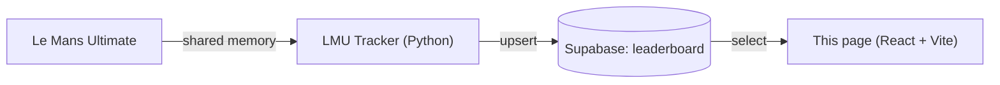

# LMU Leaderboard 🏁

A web page that shows the leaderboard of **Le Mans Ultimate** lap-time averages collected by the [LMU Tracker](https://github.com/FilipKLGAOlczyk/lmu_tracker_app) desktop app.

**Live demo:** https://lmu-leaderboard-page.vercel.app

## Tech stack

- [React](https://react.dev) 19
- [Vite](https://vite.dev)
- [Supabase](https://supabase.com) (`@supabase/supabase-js`) as the database
- ESLint
- Hosted on [Vercel](https://vercel.com)

## How it fits together



The tracker app saves the best average of five clean laps for each driver, track, class and car. This page reads the same `leaderboard` table and displays the results.

## Run locally

```bash
git clone https://github.com/FilipKLGAOlczyk/LMU_tracker_page.git
cd LMU_tracker_page
npm install
```

Create a `.env` file in the project root:

```
VITE_SUPABASE_URL=https://<your-project>.supabase.co
VITE_SUPABASE_ANON_KEY=<your-anon-key>
```

Then start the dev server:

```bash
npm run dev
```

| Script | Description |
|---|---|
| `npm run dev` | Start the development server |
| `npm run build` | Build the production bundle |
| `npm run preview` | Preview the production build locally |
| `npm run lint` | Run ESLint |

## Deployment

The page is deployed on Vercel. Add the same two environment variables in the Vercel project settings.

Only the public **anon** key belongs in the front end. Protect the table with Row Level Security (read-only access for anonymous users).
